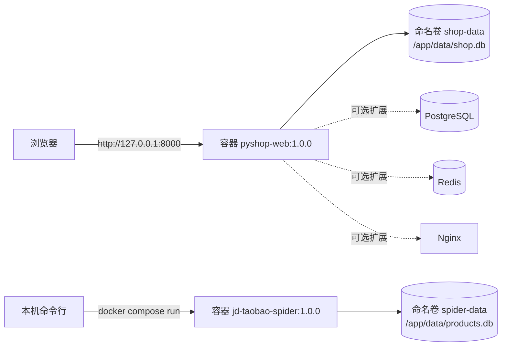

# 项目部署环境过程（本地 Docker 详细版）

> 适用对象：第一次在本机部署本仓库示例的同事。
>
> 部署方式：Windows 10/11 + Docker Desktop（WSL2 后端）+ Docker Compose v2。
>
> 结论先行：当前两个示例都用 **SQLite 文件数据库**，不需要外部数据库、缓存等中间件。必需镜像只有 `python:3.12-slim` 和两个本地构建镜像；PostgreSQL / Redis / Nginx / Adminer / MinIO 属于后续扩展镜像，默认不启动。

---

## 1. 部署目标与拓扑

| 项目 | 形态 | 端口 | 存储 |
|---|---|---|---|
| `examples/02-ecommerce-platform` | 常驻 Web 服务（uvicorn） | 8000 | 命名卷 `shop-data` 中的 SQLite |
| `examples/01-jd-taobao-spider` | 一次性采集任务（执行完退出） | 无 | 命名卷 `spider-data` 中的 SQLite |



---

## 2. 环境要求

| 项目 | 最低 | 推荐 | 检查命令 |
|---|---|---|---|
| 操作系统 | Windows 10 64 位 21H2+ | Windows 11 23H2+ | `winver` |
| CPU | 4 核 | 6 核及以上 | 任务管理器 |
| 内存 | 8 GB | 16 GB 及以上 | 任务管理器 |
| 磁盘 | 20 GB 空闲 | 40 GB 空闲 | 此电脑 |
| 虚拟化 | BIOS 已开启 | 已开启 | 任务管理器 → 性能 → 虚拟化 |
| Docker Desktop | 4.30+ | 最新稳定版 | `docker version` |
| Docker Compose | v2 | v2 | `docker compose version` |
| 端口 | 8000 空闲 | 8000、5432、6379、8080 预留 | `netstat -ano \| findstr :8000` |

> 如果「虚拟化：已禁用」，重启进 BIOS 开启 `Intel VT-x` 或 `AMD-V`（SVM），否则 WSL2 / Docker Desktop 无法启动。

---

## 3. 安装 Docker Desktop（Windows）

### 3.1 开启 WSL2

以管理员身份打开 PowerShell：

```powershell
wsl --install
wsl --status
```

第一次安装后需要重启电脑。若已安装 WSL 但版本旧：

```powershell
wsl --update
```

### 3.2 安装 Docker Desktop

1. 打开官网：https://www.docker.com/products/docker-desktop/
2. 下载 Windows 版安装包。
3. 安装时勾选 **Use WSL 2 instead of Hyper-V**。
4. 安装完成后重启，启动 Docker Desktop，接受协议。
5. 右下角鲸鱼图标变为绿色、显示 `Engine running` 即成功。

国内网络拉取镜像慢时，可在 Docker Desktop → Settings → Docker Engine 中按需配置可信的 `registry-mirrors`，改完点 **Apply & restart**。镜像加速地址会变化，请使用公司或云厂商提供的可信地址。

### 3.3 可选：给 pip 配置国内源

构建时 `pip install` 也可能慢。可在构建命令里临时指定：

```powershell
docker compose build --build-arg PIP_INDEX_URL=https://pypi.tuna.tsinghua.edu.cn/simple
```

> 两个项目的 Dockerfile 都已声明 `ARG PIP_INDEX_URL`，上面的命令可直接生效；不传该参数时正常访问默认 PyPI。

---

## 4. 验证 Docker 环境

```powershell
docker version
docker compose version
docker info
docker run --rm hello-world
```

预期：

- `docker version` 同时输出 Client 和 Server。
- `docker compose version` 输出 `Docker Compose version v2.x`。
- `docker run --rm hello-world` 打印欢迎信息。

---

## 5. 镜像与依赖清单（重点）

### 5.1 必需镜像

| 镜像 | 标签 | 来源 | 用途 |
|---|---|---|---|
| `python` | `3.12-slim` | Docker Hub | 两个项目的运行时基础镜像 |
| `pyshop-web` | `1.0.0` | 本地构建（`examples/02-ecommerce-platform/Dockerfile`） | 电商平台应用 |
| `jd-taobao-spider` | `1.0.0` | 本地构建（`examples/01-jd-taobao-spider/Dockerfile`） | 采集应用 |
| `hello-world` | `latest` | Docker Hub | 仅用于验证 Docker，不参与部署 |

构建后可用下面的命令确认：

```powershell
docker images | Select-String -Pattern 'python|pyshop-web|jd-taobao-spider'
```

### 5.2 可选中间件 / 扩展镜像

> **重要**：当前代码没有连接这些服务。启动它们不会自动提升性能或切换数据库，必须配合代码改造（见 [`docs/04-两个示例项目拓展计划.md`](04-两个示例项目拓展计划.md)）后才生效。

| 镜像 | 标签 | 用途 | 何时引入 |
|---|---|---|---|
| `postgres` | `16-alpine` | 生产级关系数据库，替换 SQLite | 多用户并发、需要备份/主从时 |
| `redis` | `7-alpine` | 缓存、限流、分布式会话 | 商品列表缓存、防刷、多实例部署 |
| `nginx` | `1.27-alpine` | 反向代理、HTTPS、静态资源 | 对外提供服务、绑定域名时 |
| `adminer` | `4` | 数据库 Web 管理界面 | 排查数据、临时运维 |
| `minio/minio` | `latest`（生产请固定 RELEASE 标签） | S3 兼容对象存储 | 商品图片、采集图片落盘 |

### 5.3 Python 第三方库清单

**采集项目 `examples/01-jd-taobao-spider`**

| 库 | 版本约束 | 用途 |
|---|---|---|
| `beautifulsoup4` | `>=4.12` | 解析 HTML |
| `httpx` | `>=0.26` | HTTP 客户端、重试基础 |
| `python-dotenv` | `>=1.0` | 读取 `.env`（可选） |
| `pytest` | `>=8.0` | 测试 |

> `soupsieve`、`httpcore`、`h11`、`anyio`、`certifi`、`idna`、`sniffio`、`colorama`、`iniconfig`、`packaging`、`pluggy` 等为 pip 自动安装的传递依赖，无需手工声明。

**电商平台 `examples/02-ecommerce-platform`**

| 库 | 版本约束 | 用途 |
|---|---|---|
| `fastapi` | `>=0.110` | Web 框架 |
| `uvicorn[standard]` | `>=0.27` | ASGI 服务器 |
| `sqlmodel` | `>=0.0.16` | ORM + 数据模型 |
| `jinja2` | `>=3.1` | 服务端模板 |
| `python-multipart` | `>=0.0.9` | 表单解析 |
| `python-dotenv` | `>=1.0` | 读取 `.env` |
| `openai` | `>=1.20` | 可选 AI 文案（OpenAI 兼容协议） |
| `pytest` | `>=8.0` | 测试 |
| `httpx` | `>=0.26` | 测试客户端 |

> `starlette`、`pydantic`、`pydantic-core`、`SQLAlchemy`、`greenlet`、`markupsafe`、`click`、`watchfiles`、`websockets` 等为传递依赖，由 pip 自动安装。

### 5.4 系统与网络依赖

- 无需安装 Node.js、Java、Go。
- 构建阶段需要访问 Docker Hub 和 PyPI。
- 真实采集还需要外网访问，并必须遵守目标站点 `robots.txt` 与授权范围。

---

## 6. 部署电商平台（`examples/02-ecommerce-platform`）

### 6.1 准备配置

```powershell
cd examples/02-ecommerce-platform
copy .env.example .env
```

生成随机密钥并写入 `.env` 的 `SECRET_KEY`：

```powershell
python -c "import secrets; print(secrets.token_urlsafe(48))"
```

同时建议修改 `.env` 中的管理员密码：

```dotenv
SECRET_KEY=上面生成的随机字符串
DATABASE_URL=sqlite:///data/shop.db
ADMIN_EMAIL=admin@example.com
ADMIN_PASSWORD=换成你自己的密码
LLM_API_KEY=
```

> `docker-compose.yml` 会用 `DATABASE_URL=sqlite:////app/data/shop.db` 覆盖容器内路径，`.env` 里写相对路径只影响本机非 Docker 运行。

### 6.2 构建镜像

```powershell
docker compose build
```

构建过程会依次执行：拉取 `python:3.12-slim` → 安装 `requirements.txt` → 复制 `app` → 创建非 root 用户 `appuser`。

### 6.3 启动服务

```powershell
docker compose up -d
docker compose ps
docker compose logs -f web
```

看到 uvicorn 输出 `Application startup complete.` 即启动成功。首次启动会自动建表并写入演示数据（分类、9 个商品、管理员、演示用户）。

按 `Ctrl+C` 退出日志跟随，不会停止容器。

### 6.4 验证部署

```powershell
Invoke-RestMethod http://127.0.0.1:8000/api/health
Invoke-RestMethod 'http://127.0.0.1:8000/api/products?limit=3'
```

浏览器打开 http://127.0.0.1:8000 ：

1. 用 `admin@example.com / admin123` 登录，进入「后台」。
2. 用 `demo@example.com / demo123` 登录，加购、下单、查看订单。
3. 确认首页商品、购物车、订单、后台四个页面均可访问。

### 6.5 数据持久化与备份

SQLite 文件在命名卷 `shop-data` 中，容器重建不丢数据。

```powershell
# 查看数据目录
docker compose exec web ls -l /app/data

# 备份到本机（容器运行中即可）
mkdir backup -Force
docker compose cp web:/app/data/shop.db .\backup\shop.db

# 恢复：先停服务，复制回去，再启动
docker compose stop web
docker compose cp .\backup\shop.db web:/app/data/shop.db
docker compose start web
```

### 6.6 更新发布

```powershell
docker compose build
docker compose up -d
```

### 6.7 停止与清理

```powershell
docker compose down          # 停止并删除容器，保留数据卷
docker compose down -v       # 同时删除数据卷（会清空数据库，谨慎）
```

---

## 7. 部署采集项目（`examples/01-jd-taobao-spider`）

采集项目是一次性任务：`docker compose up` 执行完会退出，数据写入命名卷 `spider-data`。

### 7.1 准备配置

```powershell
cd examples/01-jd-taobao-spider
copy .env.example .env
```

默认保持离线模式：

```dotenv
SPIDER_OFFLINE=1
SPIDER_DELAY_MIN=1.0
SPIDER_DELAY_MAX=3.0
SPIDER_RESPECT_ROBOTS=1
```

### 7.2 构建并运行离线采集

```powershell
docker compose build
docker compose up
```

预期输出（容器内）：

```text
[jd] 关键词=手机 抓取页=1 解析=3 新增入库=3 跳过=0
[taobao] 关键词=手机 抓取页=1 解析=3 新增入库=3 跳过=0
```

查看累计数据：

```powershell
docker compose run --rm spider stats
```

### 7.3 导出数据到本机

`run --rm` 结束后容器会被删除，不能再用 `docker cp`。推荐把本机目录挂载进容器：

```powershell
mkdir out -Force
docker compose run --rm -v "${PWD}\out:/app/out" spider export --format csv --site jd --output /app/out/jd.csv
Get-ChildItem .\out
```

### 7.4 真实采集（务必先读合规）

```powershell
docker compose run --rm -e SPIDER_OFFLINE=0 spider crawl --site jd --keyword 手机 --pages 1
```

> 只在获得授权的场景使用；不要绕过登录、验证码、付费墙或反爬；控制频率，商用走官方开放平台。

### 7.5 定时采集

Windows 任务计划程序新建任务，操作填：

```text
程序：docker
参数：compose -f C:\code\fastgithub\examples\01-jd-taobao-spider\docker-compose.yml run --rm spider crawl --site all --keyword 手机 --pages 1 --offline
起始于：C:\code\fastgithub\examples\01-jd-taobao-spider
```

生产环境更建议用服务器上的 cron 或 Kubernetes CronJob（见拓展计划）。

---

## 8. 可选中间件扩展方案（默认不启用）

下面是后续改造后可加入的 `docker-compose` 片段，**仅作示例**。当前代码未接入这些服务，直接启动不会生效。

```yaml
services:
  postgres:
    image: postgres:16-alpine
    environment:
      POSTGRES_USER: pyshop
      POSTGRES_PASSWORD: change-me
      POSTGRES_DB: pyshop
    ports:
      - "5432:5432"
    volumes:
      - pg-data:/var/lib/postgresql/data

  redis:
    image: redis:7-alpine
    ports:
      - "6379:6379"
    volumes:
      - redis-data:/data

  adminer:
    image: adminer:4
    ports:
      - "8080:8080"
    depends_on:
      - postgres

  nginx:
    image: nginx:1.27-alpine
    ports:
      - "80:80"
    volumes:
      - ./nginx.conf:/etc/nginx/conf.d/default.conf:ro
    depends_on:
      - web

volumes:
  pg-data:
  redis-data:
```

接入顺序建议：

1. SQLite → PostgreSQL：安装 `psycopg[binary]`，把 `DATABASE_URL` 改成 `postgresql+psycopg://...`，补迁移脚本。
2. 引入 Redis：加缓存层（商品列表、会话、限流），代码需要改 `services/`。
3. 引入 Nginx：反代 `web:8000`，配置 HTTPS 证书与静态资源缓存。
4. 引入 MinIO：商品图片改为对象存储 URL，替换首字母占位图。

---

## 9. 数据持久化与备份汇总

| 卷名 | 项目 | 容器路径 | 内容 | 备份方式 |
|---|---|---|---|---|
| `shop-data` | 电商平台 | `/app/data` | `shop.db` | `docker compose cp` |
| `spider-data` | 采集项目 | `/app/data` | `products.db` | `docker compose cp` / 导出 CSV |

通用备份示例：

```powershell
docker compose cp web:/app/data/shop.db .\backup\shop.db
docker compose run --rm spider export --format json --output /app/data/backup.json
```

> SQLite 适合单机演示；多实例并发写会锁库。生产请按拓展计划切 PostgreSQL。

---

## 10. 运维命令速查

```powershell
# 查看状态与日志
docker compose ps
docker compose logs -f web
docker compose logs --tail=200 web

# 进入容器排查
docker compose exec web sh
docker compose exec web python -c "import sqlite3; print(sqlite3.connect('/app/data/shop.db').execute('select count(*) from products').fetchone())"

# 重启与停止
docker compose restart web
docker compose stop web
docker compose start web
docker compose down

# 镜像与资源
docker images
docker ps -a
docker stats
docker system df

# 清理（谨慎）
docker image rm pyshop-web:1.0.0 jd-taobao-spider:1.0.0
docker system prune -f
```

---

## 11. 故障排查

| 现象 | 常见原因 | 处理 |
|---|---|---|
| `docker` 不是内部或外部命令 | 未安装或未重开终端 | 安装 Docker Desktop，重开 PowerShell |
| Docker 启动失败 | WSL2 未启用/未更新 | `wsl --update`，检查 BIOS 虚拟化 |
| `port is already allocated` | 8000 被占用 | `netstat -ano \| findstr :8000`，改端口或结束进程 |
| 拉取镜像超时 | 网络/镜像源 | 配置可信 `registry-mirrors` 后重试 |
| `pip install` 超时 | PyPI 网络 | 配置内网 PyPI 镜像或 `-i` 参数 |
| 容器启动后立即退出 | 启动报错 | `docker compose logs --tail=200 web` |
| 页面 500 | 代码/模板异常 | 看容器日志，本地 `pytest -q` 复现 |
| CSRF 校验失败 400 | 未先打开页面/禁用了 Cookie | 重新打开页面，允许 Cookie |
| 管理员登录失败 | `.env` 改过但数据已初始化 | 用现有账号；或 `down -v` 后重建（会清数据） |
| `database is locked` | 多容器/多进程同时写 SQLite | 只保留一个写实例，或切 PostgreSQL |
| 卷权限错误 | 非 root 用户写挂载目录 | 使用命名卷；绑定挂载时确认目录可写 |
| 修改代码不生效 | 未重建镜像 | `docker compose build && docker compose up -d` |

---

## 12. 安全清单

- [ ] `.env` 不提交 Git，不复制进镜像。
- [ ] `SECRET_KEY` 使用随机长字符串，不用默认值。
- [ ] 容器以非 root 用户 `appuser` 运行。
- [ ] 仅本机开发时绑定 `127.0.0.1`；对外提供服务时加 Nginx 和 HTTPS。
- [ ] 管理员密码上线前修改。
- [ ] 定期备份 `shop-data` / `spider-data`。
- [ ] 生产 Secret 使用密钥管理或 CI 变量，不写明文 YAML。
- [ ] 采集遵守 robots、服务条款与授权范围。

---

## 13. 卸载与清理

```powershell
# 停止并删除容器与网络，保留数据卷
docker compose down

# 连数据卷一起删除（不可恢复）
docker compose down -v

# 删除本地构建镜像
docker image rm pyshop-web:1.0.0 jd-taobao-spider:1.0.0

# 清理无用资源
docker system prune -f
```

---

## 14. 部署验收清单

- [ ] `docker version` 与 `docker compose version` 正常。
- [ ] `python:3.12-slim`、`pyshop-web:1.0.0`、`jd-taobao-spider:1.0.0` 三个镜像存在。
- [ ] 电商平台 `docker compose up -d` 后 `/api/health` 返回 `{"status":"ok"}`。
- [ ] 浏览器可完成注册、登录、加购、下单、查看订单、进入后台。
- [ ] 采集项目 `docker compose up` 输出京东/淘宝各 3 条，`stats` 显示累计 6 条。
- [ ] 重启容器后数据仍在（命名卷生效）。
- [ ] 能按本文完成一次 SQLite 备份与恢复。
