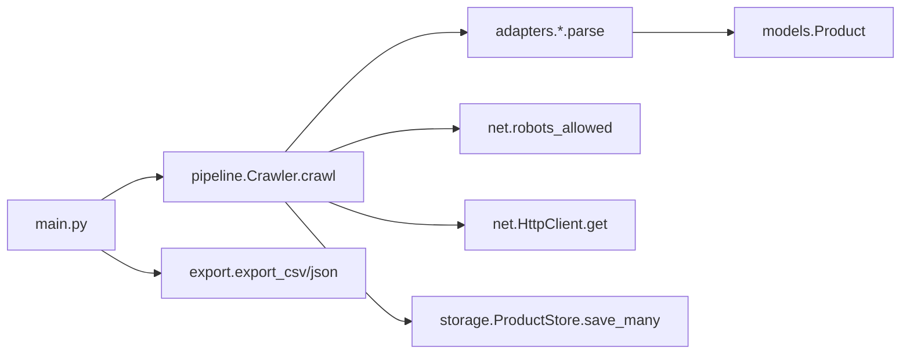
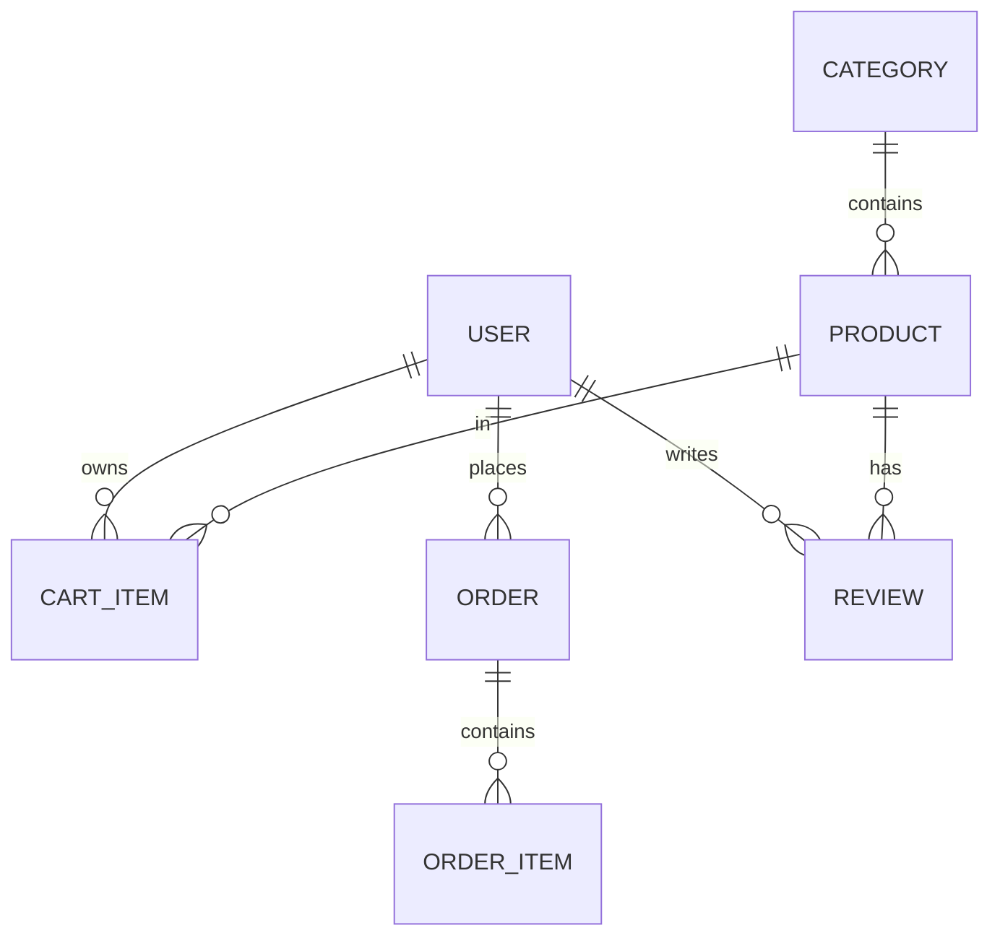
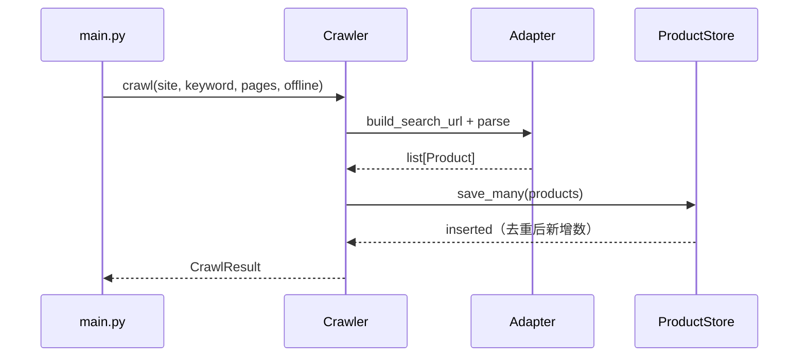
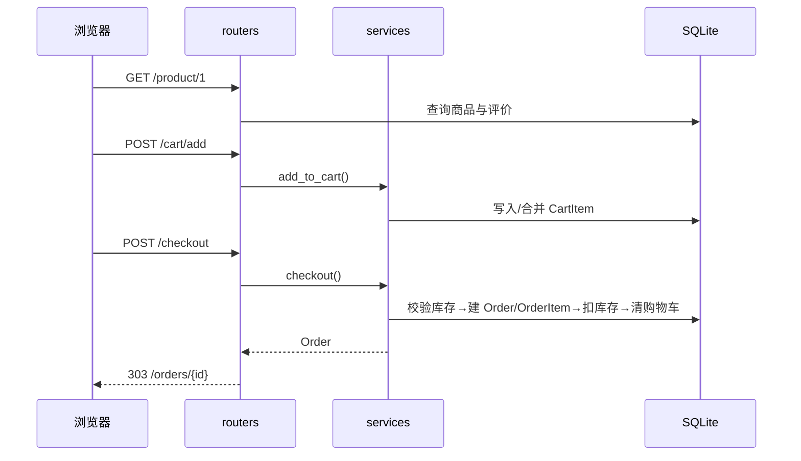

# 项目结构与 AI 开发快速定位指南

> 面向：新接入项目的同事、需要快速改代码的开发者、使用 AI 编程助手的人。
>
> 目标：看完本文，能在 1 分钟内回答「这个功能在哪、改哪个文件、跑哪条命令验证」。

---

## 1. 仓库总览

```text
C:\code\fastgithub\
├─ AGENTS.md                         # 全局规则（中文、注释、验证）
├─ Python与AI开发15天实习冲刺教程.md   # 主教程
├─ docs\                             # 本文档目录
│  ├─ 01-项目部署环境过程-Docker.md
│  ├─ 02-本地项目编译与调试步骤.md
│  ├─ 03-项目结构与AI开发快速定位指南.md
│  └─ 04-两个示例项目拓展计划.md
└─ examples\
   ├─ README.md                      # 两个项目总览
   ├─ 01-jd-taobao-spider\           # 采集项目
   └─ 02-ecommerce-platform\         # 电商平台
```

---

## 2. 两个项目的职责边界

| 项目 | 负责 | 不负责 |
|---|---|---|
| `01-jd-taobao-spider` | 抓取、解析、去重、落库、导出 | 不提供 Web 页面，不做交易 |
| `02-ecommerce-platform` | 用户、商品、购物车、订单、后台 | 不负责外部数据采集 |

两者当前通过 SQLite 文件解耦，未来按 [`docs/04`](04-两个示例项目拓展计划.md) 通过导入接口形成闭环。

---

## 3. 采集项目模块地图

根目录：`examples/01-jd-taobao-spider/`

| 文件 | 职责 | 关键符号 | 常见改动 |
|---|---|---|---|
| `main.py` | CLI 入口、子命令分发 | `main`、`build_parser`、`cmd_crawl`、`cmd_export`、`cmd_stats` | 加子命令、改默认参数 |
| `pipeline.py` | 采集流水线 | `Crawler`、`Crawler.crawl` | 改流程、加步骤 |
| `config.py` | 环境配置 | `Settings`、`DEFAULT_UA` | 加配置项 |
| `models.py` | 统一数据模型 | `Product`、`CrawlResult` | 加字段 |
| `adapters/base.py` | 适配器抽象 | `BaseAdapter` | 定义新接口 |
| `adapters/jd.py` | 京东解析 | `JdAdapter.parse`、`_parse_item` | 改选择器 |
| `adapters/taobao.py` | 淘宝解析 | `TaobaoAdapter.parse`、`_extract_json` | 改 JSON/HTML 解析 |
| `adapters/__init__.py` | 适配器注册表 | `ADAPTERS` | 注册新站点 |
| `net/http_client.py` | HTTP 重试/限速 | `HttpClient.get` | 改退避、超时 |
| `net/robots.py` | robots 检查 | `robots_allowed` | 改合规策略 |
| `utils/text.py` | 文本/价格解析 | `clean_text`、`parse_price`、`parse_int` | 加清洗规则 |
| `storage.py` | SQLite 存储 | `ProductStore`、`SCHEMA`、`COLUMNS` | 改表、去重逻辑 |
| `export.py` | 导出 | `export_csv`、`export_json` | 加格式 |
| `fixtures/` | 离线 HTML 样例 | `jd_search.html`、`taobao_search.html` | 补样例 |
| `tests/test_spider.py` | 测试 | 各 `test_*` | 补回归 |

采集调用链：



---

## 4. 电商平台模块地图

根目录：`examples/02-ecommerce-platform/`

| 文件 | 职责 | 关键符号 | 常见改动 |
|---|---|---|---|
| `app/main.py` | 应用工厂、CSRF 中间件、路由注册 | `create_app`、`lifespan`、`app` | 加中间件、注册新路由 |
| `app/config.py` | 配置 | `Settings`、`get_settings` | 加环境变量 |
| `app/database.py` | 引擎/会话 | `engine`、`init_db`、`get_session` | 换数据库 |
| `app/models.py` | 7 张表模型 | `User`、`Product`、`Order` 等 | 加表/字段 |
| `app/security.py` | 密码与会话签名 | `hash_password`、`create_session_token` | 改认证 |
| `app/deps.py` | 依赖注入 | `get_current_user`、`require_admin`、`verify_csrf` | 改权限/CSRF |
| `app/templating.py` | 模板渲染 | `render`、`templates` | 注入全局变量 |
| `app/seed.py` | 演示数据 | `seed_all`、`PRODUCTS` | 改初始数据 |
| `app/routers/auth.py` | 注册/登录/退出 | `register_submit`、`login_submit` | 改登录流程 |
| `app/routers/products.py` | 首页/详情/评价 | `index`、`product_detail`、`add_review` | 改商品展示 |
| `app/routers/cart.py` | 购物车页面 | `cart_page`、`cart_add`、`cart_update` | 改购物车交互 |
| `app/routers/orders.py` | 下单/订单 | `checkout_submit`、`orders_page` | 改订单入口 |
| `app/routers/admin.py` | 后台 CRUD | `dashboard`、`product_create`、`order_status` | 改后台 |
| `app/routers/api.py` | JSON API | `health`、`list_products`、`product_pitch` | 加接口 |
| `app/services/cart.py` | 购物车业务 | `add_to_cart`、`get_cart_detail` | 改加购规则 |
| `app/services/order.py` | 下单业务 | `checkout` | 改库存/订单逻辑 |
| `app/services/ai.py` | AI 文案 | `generate_product_pitch` | 换模型/提示词 |
| `app/templates/` | 页面模板 | `base.html`、`index.html` 等 | 改页面 |
| `app/static/style.css` | 样式 | - | 改视觉 |
| `tests/test_shop.py` | 测试 | 各 `test_*` | 补回归 |

> 记住一句话：**路由管参数和响应，业务在 `services/`，数据在 `models/`，安全在 `security.py` / `deps.py`。**

---

## 5. 数据模型



| 表 | 关键字段 | 说明 |
|---|---|---|
| `users` | `email` 唯一、`password_hash`、`is_admin` | 用户与管理员标记 |
| `categories` | `name`、`slug` | 分类 |
| `products` | `category_id`、`name`、`price`、`stock`、`active` | 商品，软删除 |
| `cart_items` | `user_id`、`product_id`、`quantity` | 购物车 |
| `orders` | `user_id`、`status`、`total`、`address` | 订单 |
| `order_items` | `order_id`、`product_name`、`unit_price`、`quantity` | 下单快照 |
| `reviews` | `product_id`、`user_id`、`rating`、`comment` | 评价 |

订单状态：`pending` → `paid` → `shipped` → `completed`，另有 `cancelled`。

---

## 6. 接口清单

### 6.1 采集项目 CLI

| 命令 | 参数 | 说明 |
|---|---|---|
| `python main.py` | 无 | 离线演示京东 + 淘宝 |
| `python main.py crawl` | `--site {jd,taobao,all}`、`--keyword`、`--pages`、`--offline` | 采集 |
| `python main.py export` | `--format {csv,json}`、`--site`、`--limit`、`--output` | 导出 |
| `python main.py stats` | 无 | 统计各站点条数 |

### 6.2 电商平台页面与表单

| 方法 | 路径 | 权限 | 关键参数 | 行为 |
|---|---|---|---|---|
| GET | `/` | 公开 | `q`、`category`、`page` | 首页/搜索/分页 |
| GET | `/product/{id}` | 公开 | - | 详情，不存在 404 |
| GET | `/register` | 公开 | - | 注册页 |
| POST | `/register` | 公开 | `email`、`name`、`password`、`csrf_token` | 303 到首页 |
| GET | `/login` | 公开 | `next` | 登录页 |
| POST | `/login` | 公开 | `email`、`password`、`next`、`csrf_token` | 303，失败回显 |
| POST | `/logout` | 登录 | `csrf_token` | 303 到首页 |
| GET | `/cart` | 登录 | - | 未登录跳 `/login` |
| POST | `/cart/add` | 登录 | `product_id`、`quantity`、`csrf_token` | 303 到购物车 |
| POST | `/cart/update` | 登录 | `item_id`、`quantity`、`csrf_token` | 数量 ≤0 即删除 |
| POST | `/cart/remove` | 登录 | `item_id`、`csrf_token` | 删除条目 |
| POST | `/checkout` | 登录 | `address`、`csrf_token` | 303 到订单详情 |
| GET | `/orders` | 登录 | - | 我的订单 |
| GET | `/orders/{id}` | 登录 + 归属 | - | 非本人 404 |
| POST | `/product/{id}/review` | 登录 | `rating`、`comment`、`csrf_token` | 303 回详情 |

### 6.3 后台（管理员）

| 方法 | 路径 | 权限 | 关键参数 | 行为 |
|---|---|---|---|---|
| GET | `/admin` | 管理员 | - | 仪表盘 + 最近订单 |
| GET | `/admin/products` | 管理员 | - | 商品列表 |
| GET | `/admin/products/new` | 管理员 | - | 新增表单 |
| POST | `/admin/products` | 管理员 | 商品字段 + `csrf_token` | 创建后 303 |
| GET | `/admin/products/{id}/edit` | 管理员 | - | 编辑表单 |
| POST | `/admin/products/{id}` | 管理员 | 商品字段 + `csrf_token` | 更新后 303 |
| POST | `/admin/products/{id}/delete` | 管理员 | `csrf_token` | 软删除（`active=False`） |
| POST | `/admin/orders/{id}/status` | 管理员 | `status`、`csrf_token` | 状态流转 |

> 未登录访问后台返回 401；已登录但非管理员返回 403；写操作缺少 CSRF 返回 400。

### 6.4 JSON API

| 方法 | 路径 | 权限 | 说明 |
|---|---|---|---|
| GET | `/api/health` | 公开 | `{"status":"ok"}` |
| GET | `/api/products` | 公开 | 支持 `q`、`limit`，返回商品数组 |
| GET | `/api/products/{id}/pitch` | 公开 | AI/模板文案，商品不存在 404 |

### 6.5 静态资源

`/static/style.css` 由 `app/main.py` 的 `StaticFiles` 挂载。

---

## 7. 关键数据流

### 7.1 采集入库



### 7.2 浏览 → 加购 → 下单



### 7.3 认证与 CSRF

```text
首次 GET 任意页面
  → 中间件下发 csrf_token Cookie
  → 模板渲染隐藏字段 csrf_token
POST 表单
  → deps.verify_csrf(request, form_token)
  → 比对 Cookie 与表单，不一致 400
登录成功
  → 写入 HMAC 签名 session Cookie（HttpOnly）
后续请求
  → get_current_user 解码 session → 查询 User
```

---

## 8. AI 开发快速定位表

> 用法：把「我要做什么」一列直接交给 AI，并附上「先看 / 改动 / 验证」三列，能显著降低它改错文件。

| 我要做什么 | 先看 | 主要改动 | 验证 |
|---|---|---|---|
| 新增一个采集站点 | `adapters/base.py`、`adapters/jd.py` | 新建 `adapters/xxx.py`，在 `ADAPTERS` 注册，加 fixture | `pytest -q` |
| 修改京东/淘宝选择器 | 对应 adapter 的 `parse` | 只改该文件 | fixture 测试 |
| 调整重试/限速 | `net/http_client.py`、`config.py` | `Settings` 与 `HttpClient` | 单测/离线跑 |
| 新增导出格式 | `export.py`、`main.py` | 加函数 + CLI 分支 | 导出文件检查 |
| 采集加字段 | `models.py`、`storage.py` | `Product`、`SCHEMA`、`COLUMNS` | `pytest -q` |
| 新增商城页面 | `routers/products.py`、`templates/` | 路由 + 模板 + 导航 | 浏览器访问 |
| 新增写操作表单 | `routers/*.py`、`templates/*.html`、`deps.verify_csrf` | 路由 + 隐藏 CSRF 字段 | 缺 CSRF 应 400 |
| 改购物车规则 | `services/cart.py` | `add_to_cart` / `update_quantity` | `pytest -q` |
| 改下单/库存 | `services/order.py` | `checkout` | 下单测试 |
| 改权限 | `deps.py`、`models.User` | `require_user` / `require_admin` | 401/403 测试 |
| 加表或字段 | `models.py`、`seed.py` | 模型 + 初始化数据 | 重建库 + 测试 |
| 加 JSON 接口 | `routers/api.py` | 新路由 | `Invoke-RestMethod` |
| 改 AI 文案 | `services/ai.py`、`routers/api.py` | 提示词/模型 | 无 Key 时跑兜底 |
| 改视觉样式 | `static/style.css`、`templates/` | CSS/结构 | 浏览器 |
| 改部署 | `Dockerfile`、`docker-compose.yml` | 镜像/端口/卷 | `docker compose up` |

---

## 9. 命名与分层约定

1. **路由薄、服务厚**：`routers/` 只做参数校验与响应；业务写 `services/`。
2. **数据集中**：所有表在 `models.py`，不要在路由里写裸 SQL。
3. **安全集中**：密码/令牌在 `security.py`，权限与 CSRF 在 `deps.py`。
4. **模板不写业务**：模板只做展示，复杂计算放服务层。
5. **注释中文**：函数/类有 docstring，关键分支有行内注释（见 `AGENTS.md`）。
6. **写操作必带 CSRF**：新增表单别忘了隐藏字段。
7. **资源必校验归属**：订单、购物车查询必须带 `user_id`。

---

## 10. 新人阅读顺序（约 1.5 小时）

1. `examples/README.md`（5 分钟）
2. 采集项目：`main.py` → `pipeline.py` → `adapters/jd.py` → `storage.py`（25 分钟）
3. 电商平台：`app/main.py` → `app/models.py` → `app/routers/products.py` → `app/services/order.py`（40 分钟）
4. 安全：`app/security.py` → `app/deps.py`（15 分钟）
5. 测试：`tests/`（10 分钟）
6. 拓展计划：`docs/04-两个示例项目拓展计划.md`（5 分钟）

---

## 11. 常见定位问题

| 问题 | 答案 |
|---|---|
| 商品列表在哪查？ | `routers/products.py::index` |
| 加购为什么合并？ | `services/cart.py::add_to_cart` |
| 下单扣库存在哪？ | `services/order.py::checkout` |
| 为什么没登录也能看首页？ | 首页只依赖 `get_current_user`（可空），未强制登录 |
| 为什么后台报 403？ | `deps.require_admin` 校验 `is_admin` |
| 为什么 POST 返回 400？ | `deps.verify_csrf` 校验失败 |
| 采集解析 0 条？ | 对应 adapter 的 `parse` 选择器失效 |
| 数据表在哪定义？ | `app/models.py`；采集在 `storage.py` 的 `SCHEMA` |
| 演示数据在哪？ | `app/seed.py` |
| 部署怎么跑？ | `docs/01-项目部署环境过程-Docker.md` |
