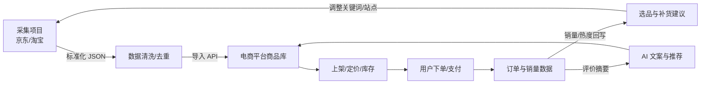

# 两个示例项目的拓展计划：从数据采集到电商交易闭环

> 背景：目前 `01-jd-taobao-spider` 与 `02-ecommerce-platform` 是两个独立项目。你的想法是把采集到的商品数据接入电商平台，形成「采集 → 清洗 → 上架 → 交易 → 反馈 → 再采集」的闭环。本文给出可落地的分阶段方案、数据契约、代码改造点和验收标准。

---

## 1. 现状

| 项目 | 已有能力 | 缺口 |
|---|---|---|
| 采集项目 | 京东/淘宝搜索页解析、去重、SQLite、CSV/JSON 导出 | 没有标准导入接口、没有价格历史、没有调度与推送 |
| 电商平台 | 用户、商品、购物车、订单、评价、后台、CSRF、测试 | 商品靠手工/种子数据，没有外部来源字段，没有导入入口 |

两者共同点：都用 SQLite，都有统一商品概念，都已有测试基座，适合先做「低耦合导入」而不是直接共享数据库。

---

## 2. 目标闭环



闭环的关键不是「把两个库连起来」，而是**统一商品主数据 + 幂等导入 + 交易数据回流**。

> 想先看两个系统合在一起的完整业务流程图，见 [`docs/05-业务与系统联合流程图.md`](05-业务与系统联合流程图.md)。

---

## 3. 统一数据契约

采集端输出、导入端接收都遵循同一份字段定义。

| 字段 | 类型 | 必填 | 说明 |
|---|---|---|---|
| `source` | string | 是 | 来源站点，如 `jd`、`taobao` |
| `source_sku` | string | 是 | 来源商品唯一 ID，与 `source` 组成幂等键 |
| `title` | string | 是 | 商品标题 |
| `price` | number | 是 | 采集价（元） |
| `currency` | string | 否 | 默认 `CNY` |
| `shop` | string | 否 | 店铺名 |
| `sales` | integer | 否 | 销量（可空） |
| `comments` | integer | 否 | 评价数（可空） |
| `source_url` | string | 否 | 原始商品链接 |
| `image_url` | string | 否 | 主图地址 |
| `category` | string | 否 | 采集端推断的分类（后续映射） |
| `captured_at` | string | 是 | 采集时间 ISO8601 |
| `raw_hash` | string | 是 | 关键字段内容哈希，用于判断是否变化 |

导入到电商平台后，商品表新增：

| 字段 | 说明 |
|---|---|
| `source` | 来源站点 |
| `source_sku` | 来源商品 ID |
| `source_url` | 原始链接 |
| `sync_status` | `imported` / `updated` / `ignored` |
| `last_synced_at` | 最近同步时间 |

唯一约束：`UNIQUE(source, source_sku)`，保证重复导入不产生重复商品。

---

## 4. 集成方案对比

| 方案 | 做法 | 优点 | 缺点 | 建议 |
|---|---|---|---|---|
| A. 共享 SQLite 文件 | 两个项目挂同一个卷 | 最快 | 锁冲突、强耦合、无法多实例 | 仅本地演示 |
| B. REST 导入 API | 采集端 POST 到电商平台 | 解耦、可鉴权、可幂等 | 需要写接口 | **推荐** |
| C. 消息队列 | Redis/RabbitMQ 异步消费 | 削峰、可扩展 | 引入中间件与运维成本 | 数据量大时 |
| D. CSV 批量导入 | 后台手动上传 | 简单、可审计 | 实时性差 | 作为兜底 |

推荐路线：**B 为主，D 为兜底，C 作为规模化升级**。

### 4.1 推荐接口

```http
POST /api/import/products
Authorization: Bearer <IMPORT_TOKEN>
Content-Type: application/json
Idempotency-Key: jd:100012043978:2026-11-09
```

请求体：

```json
{
  "source": "jd",
  "source_sku": "100012043978",
  "title": "Apple iPhone 15 128GB 蓝色",
  "price": 3999.0,
  "currency": "CNY",
  "shop": "Apple京东自营旗舰店",
  "sales": 0,
  "comments": 100000,
  "source_url": "https://item.jd.com/100012043978.html",
  "image_url": "",
  "category": "digital",
  "captured_at": "2026-11-09T10:00:00",
  "raw_hash": "sha256:..."
}
```

响应：

```json
{
  "status": "created",
  "product_id": 10,
  "source": "jd",
  "source_sku": "100012043978"
}
```

`status` 取值：`created` / `updated` / `ignored`。

---

## 5. 分阶段计划

### Phase 0：统一契约与字段（0.5 周）

目标：两端能对上字段。

- 采集端 `Product` 增加 `currency`、`category`、`raw_hash`。
- 电商端 `Product` 增加 `source`、`source_sku`、`source_url`、`sync_status`、`last_synced_at`。
- 定稿 JSON 契约（本文第 3 节）。
- 补字段序列化/反序列化测试。

验收：采集导出的 JSON 能被一个 Pydantic 模型完整校验。

### Phase 1：采集侧标准化（1 周）

目标：采集结果可直接推送。

- `export.py` 新增 `export_normalized_json`，输出契约字段。
- `storage.py` 增加 `price_history` 表，记录每次价格变化。
- 新增 `push.py`：带 `IMPORT_TOKEN` 调用电商导入 API，失败重试。
- 支持 `--push` 参数，或独立子命令 `python main.py push --file data/latest.json`。
- 调度：Windows 任务计划 / Linux cron / K8s CronJob。

验收：

- 离线样例 → 标准化 JSON → 推送成功。
- 重复推送同一 `Idempotency-Key`，电商端返回 `ignored`，商品数不增加。

### Phase 2：电商侧导入与上架（1 周）

目标：外部商品进入商品库并可管理。

- 新增 `app/routers/imports.py`：`POST /api/import/products`。
- 新增 `app/services/imports.py`：幂等 upsert、字段校验、分类映射。
- 新增 `IMPORT_TOKEN` 配置（环境变量），用常量时间比较。
- 后台新增「导入商品」列表与审核操作（上架/忽略）。
- `Product` 唯一约束 `UNIQUE(source, source_sku)`。
- 测试：创建、更新、重复导入、非法字段、鉴权失败。

验收：

- 100 条导入耗时 < 5 秒（本地 SQLite）。
- 重复导入不产生重复行。
- 后台可一键上架。

### Phase 3：交易数据回流（1 周）

目标：让采集与运营互相驱动。

- 订单完成后累计商品销量（新增 `product_stats` 或订单聚合查询）。
- 销量/热度回写到商品排序与「猜你喜欢」。
- 价格历史 + 当前售价，生成「低于历史均价」标签。
- 库存低于阈值时生成补货建议。
- 采集任务优先采集高销量/高点击的类目与关键词。

验收：

- 下单后商品销量变化可见。
- 后台能看到「热销 Top N」「需补货 Top N」。

### Phase 4：AI 增强（1–2 周）

目标：用 AI 提升上架效率与转化。

- 商品标题/卖点生成：扩展 `services/ai.py`，批量生成后人工确认。
- 采集标题 → 电商标题改写（去营销词、补规格）。
- 评论摘要：对 `reviews` 做聚类摘要。
- 选品推荐：结合采集销量、价格、评价数给候选清单。
- 类目自动映射：采集 `category` → 平台 `categories`。

验收：

- 无 LLM Key 时全部降级可用。
- 生成内容必须人工可编辑，不直接覆盖商品描述。

### Phase 5：工程化与规模化（2 周）

- SQLite → PostgreSQL（`psycopg[binary]` + Alembic）。
- Redis：缓存商品列表、限流、任务队列。
- MinIO：商品图片对象存储。
- Nginx：反代 + HTTPS。
- CI/CD：pytest → 构建镜像 → 推送 → 部署。
- 监控：健康检查、采集成功率、导入失败率、订单量。

验收：

- 多实例部署下无 SQLite 锁问题。
- 采集失败可告警、可重试、可补偿。

---

## 6. 代码改造清单（按文件）

### 采集项目

| 文件 | 改造 |
|---|---|
| `models.py` | `Product` 加 `currency`、`category`、`raw_hash` |
| `utils/text.py` | 加 `content_hash()` |
| `storage.py` | 建 `price_history` 表；`save_many` 同时写价格历史 |
| `export.py` | 加 `export_normalized_json()` |
| `push.py`（新增） | 调用 `POST /api/import/products`，带 Token 与幂等键 |
| `main.py` | 加 `push` 子命令与 `--push` 选项 |
| `tests/test_spider.py` | 补标准化导出、价格历史、推送重试测试 |

### 电商平台

| 文件 | 改造 |
|---|---|
| `app/models.py` | `Product` 加来源字段；新增导入审计表（可选） |
| `app/config.py` | 加 `import_token` |
| `app/routers/imports.py`（新增） | 导入接口 |
| `app/services/imports.py`（新增） | 幂等 upsert、分类映射 |
| `app/routers/admin.py` | 导入审核、上架/忽略 |
| `app/templates/admin_*.html` | 导入列表与操作按钮 |
| `app/services/order.py` | 下单后更新销量/统计 |
| `app/services/ai.py` | 批量文案与摘要 |
| `tests/` | 导入幂等、鉴权、上架、销量回流测试 |

---

## 7. 去重、合并与定价策略

### 7.1 去重

- 同源去重：`UNIQUE(source, source_sku)`。
- 内容未变：比较 `raw_hash`，不变则 `ignored`，避免无意义更新。
- 跨平台同款：标题规范化 + 关键规格抽取 + 相似度阈值，人工确认后合并为「主商品 + 多来源报价」。

### 7.2 定价

- 展示采集价作为参考价，平台售价单独维护，避免直接覆盖。
- 价格历史用于「历史低价」「涨价提醒」。
- 规则示例：平台价 = 采集价 × 系数 + 固定运费，系数可按类目配置。

### 7.3 库存

- 外部商品导入时库存默认 0，需人工或规则初始化。
- 不允许把外部销量直接当库存，避免超卖。

---

## 8. 合规与授权（必须前置）

- 只接入公开且授权允许的数据；商用走京东联盟、淘宝开放平台等官方接口。
- 不绕过登录、验证码、付费墙、反爬。
- 不存储、不展示个人隐私数据。
- 图片、标题、描述存在版权风险，上架前需确认授权或改写。
- 导入接口必须鉴权、限流、审计，防止被滥用写入垃圾商品。

---

## 9. 里程碑与时间表

| 周次 | 阶段 | 交付物 |
|---|---|---|
| 第 1 周 | Phase 0 + Phase 1 启动 | 数据契约、来源字段、标准化导出 |
| 第 2 周 | Phase 1 | 价格历史、推送客户端、调度 |
| 第 3 周 | Phase 2 | 导入 API、幂等 upsert、后台审核 |
| 第 4 周 | Phase 3 | 销量回流、热销/补货统计 |
| 第 5 周 | Phase 4 | AI 文案、评论摘要、选品推荐 |
| 第 6 周 | Phase 5 | Postgres/Redis/MinIO/Nginx、CI/CD |

> 单人全职约 6 周；业余每天 2 小时约 3 个月。可先只做 Phase 0–2 打通最小闭环。

---

## 10. 验收指标（KPI）

| 指标 | 目标 |
|---|---|
| 采集成功率（授权源） | ≥ 95% |
| 导入幂等率 | 100%（重复请求不新增行） |
| 数据新鲜度 | 高优类目 ≤ 24 小时 |
| 100 条商品导入耗时 | < 5 秒（SQLite） |
| 订单库存准确率 | 100%（不超卖） |
| 关键流程测试覆盖 | 采集→导入→下单→回流 全链路有测试 |
| 上架人工耗时 | 相比纯手工下降 ≥ 50% |

---

## 11. 风险与对策

| 风险 | 影响 | 对策 |
|---|---|---|
| 反爬/封禁 | 采集中断 | 官方 API、降频、缓存、授权数据 |
| 数据质量差 | 垃圾商品 | 字段校验、标题清洗、人工审核 |
| 重复/同款混乱 | 商品冗余 | 幂等键 + 相似度合并 + 人工确认 |
| SQLite 锁 | 并发写失败 | 切 PostgreSQL，单写实例 |
| 图片版权 | 法律风险 | 授权图片、改写、对象存储留痕 |
| 导入接口被滥用 | 数据污染 | Token、限流、审计、白名单 |
| 价格/库存不同步 | 超卖或亏损 | 售价独立维护，库存人工/规则初始化 |

---

## 12. 第一批任务（可直接开工）

1. 采集端：`Product` 增加 `currency`、`category`、`raw_hash`，补 `content_hash()`。
2. 采集端：新增 `export_normalized_json()` 与测试。
3. 采集端：新增 `storage.price_history` 与写入逻辑。
4. 电商端：`Product` 增加来源字段与唯一约束，补迁移脚本。
5. 电商端：新增 `POST /api/import/products` + `services/imports.py`，带 Token 与幂等键。
6. 电商端：后台导入列表与「上架/忽略」操作。
7. 联调：离线采集 → 标准化 JSON → 导入 → 首页可见 → 下单 → 销量回流。
8. 补一条端到端测试，纳入 `pytest -q`。

完成以上 8 项，就打通了「采集 → 上架 → 交易」的最小闭环，后续再叠加价格历史、AI 选品与工程化。

---

## 13. 汇报/面试话术

- 我不是把两个项目硬连起来，而是先定统一商品契约，再用幂等导入接口解耦，采集端和电商端可以独立演进。
- 闭环的关键是三个唯一：来源唯一键、内容哈希、订单回流；保证不重复、不脏写、可追踪。
- 我优先保证合规和数据质量，商用数据走官方开放平台；AI 只做辅助生成，必须人工确认。
- 工程化路径是 SQLite → PostgreSQL、单机 → Compose/K8s、手工 → 调度与 CI/CD。
