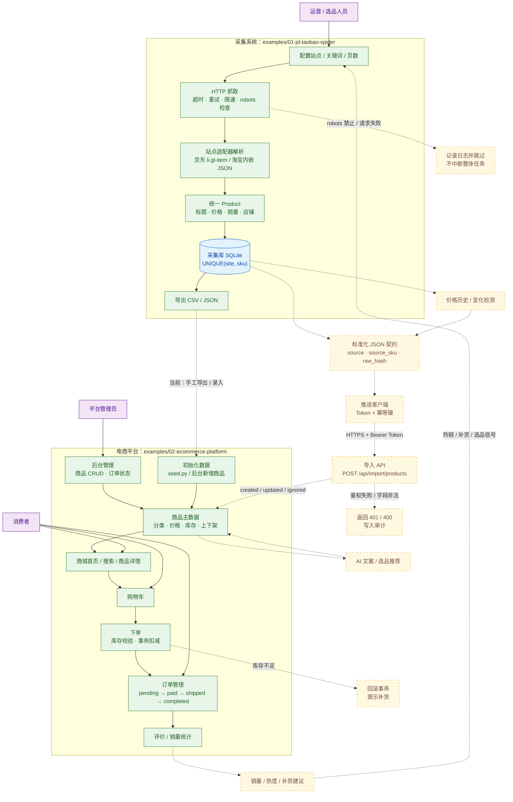
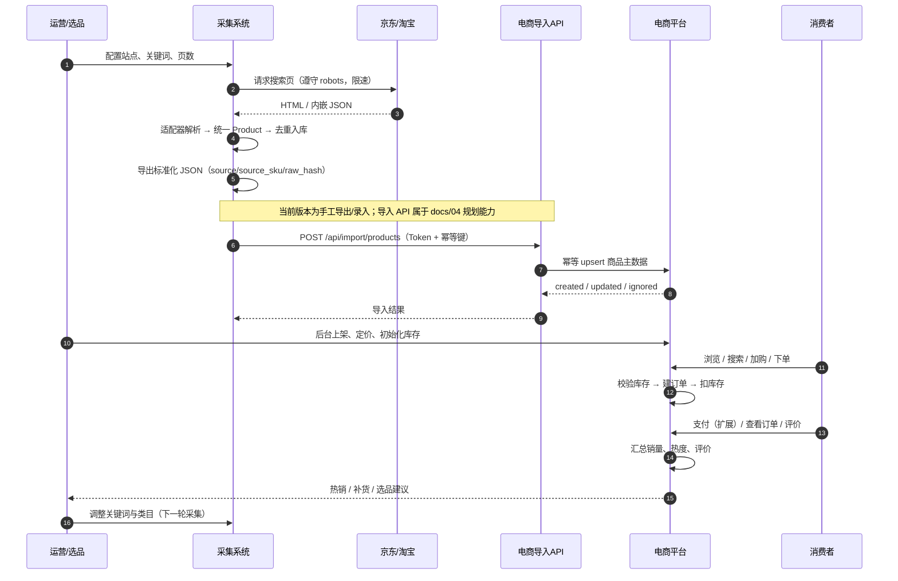

# 业务与两个系统联合使用流程图

> 本文把「采集系统」和「电商平台」放在同一张业务图里，讲清楚谁在什么时候做什么、两个系统如何交接数据，以及目标闭环。
>
> **图例**：实线 = 当前代码已实现的自动流程；虚线 = `docs/04` 规划中的能力，或当前的人工过渡方式。

---

## 1. 业务总流程图

---

## 2. 两系统联合使用时序图

---

## 3. 业务说明

### 3.1 角色分工

| 角色 | 在采集系统 | 在电商平台 |
|---|---|---|
| 运营 / 选品 | 配置站点、关键词、页数；看采集结果 | 审核导入商品、上架、定价、补货 |
| 平台管理员 | 无 | 商品 CRUD、订单状态、权限管理 |
| 消费者 | 无 | 浏览、搜索、加购、下单、评价 |

### 3.2 当前已实现的流程（实线）

1. 运营在采集系统配置站点和关键词。
2. 采集系统抓取、解析、清洗成统一 `Product`，写入 SQLite（`UNIQUE(site, sku)` 去重）。
3. 导出 CSV / JSON。
4. 通过 `seed.py` 或后台「新增商品」把数据录入电商平台（当前临时方案）。
5. 消费者在商城浏览、加购、下单；系统校验库存并在事务内扣减。
6. 订单状态流转，用户可评价，后台可管理商品与订单。

### 3.3 目标闭环（虚线）

1. 采集系统按标准契约输出 JSON（`source`、`source_sku`、`raw_hash`）。
2. 推送客户端携带 `IMPORT_TOKEN` 和幂等键调用导入 API。
3. 电商平台幂等 upsert 商品主数据，返回 `created / updated / ignored`。
4. 运营上架、定价、初始化库存。
5. 消费者完成下单、支付（扩展）、评价。
6. 平台汇总销量、热度、评价。
7. 选品/补货信号回到采集系统，指导下一轮关键词与类目。

### 3.4 两个系统的边界与契约

| 项 | 约定 |
|---|---|
| 职责边界 | 采集系统只负责「获取 + 标准化」，不直接写电商库；电商平台只负责「导入 + 交易 + 运营」，不直接抓取 |
| 幂等键 | 采集端 `UNIQUE(site, sku)`；导入端 `UNIQUE(source, source_sku)` + `Idempotency-Key` |
| 变化检测 | `raw_hash` 不变则返回 `ignored`，避免无意义更新 |
| 鉴权 | 导入接口使用 `Authorization: Bearer <IMPORT_TOKEN>`，常量时间比较 |
| 失败处理 | 采集单页失败跳过并记录；导入失败返回 401/400 并写审计；下单库存不足回滚 |
| 数据所有权 | 采集价与平台售价分离，平台售价不被采集结果直接覆盖 |

---

## 4. 异常与补偿

| 场景 | 系统 | 处理 |
|---|---|---|
| robots 禁止 / 抓取失败 | 采集 | 记录错误并跳过，不中断整体任务 |
| 页面改版导致解析 0 条 | 采集 | 改对应 adapter，用 fixture 回归 |
| 重复导入 | 电商 | 唯一键 + 幂等键，返回 `ignored` |
| 字段非法 / Token 错误 | 电商 | 返回 400 / 401，写审计日志 |
| 库存不足 | 电商 | 下单事务回滚，提示补货 |
| 图片/分类缺失 | 电商 | 允许为空，后台人工补全 |

---

## 5. 当前 vs 目标

| 能力 | 当前 | 目标 |
|---|---|---|
| 数据传递 | 手工导出 / 后台录入 | 导入 API 自动推送 |
| 幂等 | 采集库唯一键 | 两端唯一键 + `Idempotency-Key` |
| 价格变化 | 无 | `price_history` 价格历史 |
| 销量回流 | 无 | `product_stats` 或订单聚合 |
| AI | 单商品文案接口 | 批量文案、评论摘要、选品推荐 |
| 工程化 | SQLite 单机 | PostgreSQL + Redis + MinIO + Nginx |

---

## 6. 一句话总结

运营在采集系统选品采集，数据标准化后经导入 API 进入电商平台；消费者在平台完成交易与评价，订单和评价数据回流，反过来指导下一轮采集、定价与补货，形成「采集 → 上架 → 交易 → 反馈 → 再采集」的闭环。
