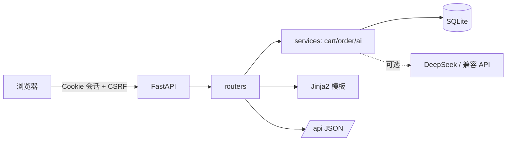

# 大项目二：电商平台全栈开发（PyShop）

> 一个可运行、可测试、可容器化的电商平台最小闭环：注册登录、商品浏览/搜索、购物车、下单、订单查询、评价、后台商品与订单管理，以及可选的 AI 文案接口。

## 功能清单

| 模块 | 功能 |
|---|---|
| 用户 | 邮箱注册、登录、退出；PBKDF2 密码哈希；HMAC 签名会话 Cookie |
| 商城 | 首页、分类筛选、关键词搜索、分页、商品详情 |
| 购物车 | 加购、改数量、删除；同一商品自动合并 |
| 下单 | 库存校验、事务扣减、订单/订单项快照、清空购物车 |
| 订单 | 我的订单、订单详情、越权访问拦截 |
| 评价 | 登录用户评分 + 文字评价 |
| 后台 | 仪表盘统计、商品增删改查（软删除）、订单状态流转 |
| AI | `/api/products/{id}/pitch` 生成商品文案；无 Key 时使用内置模板 |
| 工程 | CSRF 双提交 Cookie、pytest、Docker/Compose、JSON API |

## 技术栈

FastAPI、SQLModel、SQLite、Jinja2、python-multipart、pytest、Docker Compose。
AI 文案可选依赖 OpenAI SDK（兼容 DeepSeek / 百炼等 OpenAI 协议服务）。

## 目录结构

```text
02-ecommerce-platform/
├─ app/
│  ├─ main.py               # 应用工厂 + CSRF 中间件 + 生命周期
│  ├─ config.py             # 环境变量配置
│  ├─ database.py           # 引擎与会话
│  ├─ models.py             # User/Category/Product/CartItem/Order/OrderItem/Review
│  ├─ security.py           # 密码哈希 + 会话签名
│  ├─ deps.py               # 当前用户 / 权限 / CSRF
│  ├─ templating.py         # Jinja2 渲染辅助
│  ├─ seed.py               # 演示数据
│  ├─ routers/              # auth/products/cart/orders/admin/api
│  ├─ services/             # cart/order/ai 业务逻辑
│  ├─ templates/            # Jinja2 页面
│  └─ static/style.css
├─ tests/                   # pytest + TestClient
├─ Dockerfile
├─ docker-compose.yml
└─ requirements.txt
```

## 架构



数据模型关系：

```text
User 1─n CartItem n─1 Product n─1 Category
User 1─n Order 1─n OrderItem
User 1─n Review n─1 Product
```

## 快速开始

```powershell
cd examples/02-ecommerce-platform
py -3.12 -m venv .venv
.\.venv\Scripts\Activate.ps1
pip install -r requirements.txt

# 方式一：直接运行
uvicorn app.main:app --reload

# 方式二：生产风格
uvicorn app.main:app --host 0.0.0.0 --port 8000
```

打开 http://127.0.0.1:8000 。

初始账号（首次启动自动创建）：

| 角色 | 邮箱 | 密码 |
|---|---|---|
| 管理员 | `admin@example.com` | `admin123` |
| 普通用户 | `demo@example.com` | `demo123` |

> 生产环境务必通过 `.env` 修改 `SECRET_KEY` 和管理员密码。

## 配置

复制 `.env.example` 为 `.env`：

```dotenv
SECRET_KEY=请改成至少32位随机字符串
DATABASE_URL=sqlite:///data/shop.db
SHOP_NAME=PyShop 商城
ADMIN_EMAIL=admin@example.com
ADMIN_PASSWORD=admin123
LLM_API_KEY=
LLM_BASE_URL=https://api.deepseek.com/v1
LLM_MODEL=deepseek-chat
```

生成密钥：

```powershell
python -c "import secrets; print(secrets.token_urlsafe(48))"
```

## 测试

```powershell
pytest -q
```

覆盖：健康检查、商品列表、CSRF 拦截、注册 + 加购 + 下单 + 库存扣减、订单越权、后台权限、AI 文案兜底。

## Docker

```powershell
copy .env.example .env
docker compose up -d --build
docker compose logs -f
docker compose down
```

镜像以非 root 用户运行，SQLite 数据挂载到命名卷 `shop-data`。

## 关键设计说明（面试可直接讲）

1. **会话安全**：密码 PBKDF2-HMAC-SHA256 加盐；会话令牌用 HMAC-SHA256 签名并放 HttpOnly Cookie；`SameSite=Lax`。
2. **CSRF**：双提交 Cookie。中间件在首次响应下发 `csrf_token`，所有写操作表单携带同名隐藏字段，服务端做常量时间比较。
3. **下单事务**：先校验全部库存，再创建订单、写订单项快照、扣库存、清购物车，最后一次性提交，避免部分扣减。
4. **越权防护**：订单详情必须满足 `order.user_id == current_user.id`；购物车条目校验归属。
5. **软删除**：商品下架只置 `active=False`，历史订单仍可追溯。
6. **AI 可降级**：配置 Key 才调用大模型，失败或未配置时返回模板文案，保证演示与测试稳定。
7. **分层**：路由只做参数与响应，业务放 `services/`，便于单测和替换。

## 已知限制与下一步

- SQLite 适合演示；生产建议 PostgreSQL，并引入 Alembic 迁移。
- 未接入真实支付；`status` 仅演示状态流转。
- 未做限流、验证码、邮箱验证；生产需要补。
- 商品图片用首字母占位，可替换为对象存储 URL。
- 管理后台目前是服务端渲染，可再拆出独立 SPA。

## 常用接口

| 方法 | 路径 | 说明 |
|---|---|---|
| GET | `/` | 首页（支持 `q`、`category`、`page`） |
| GET | `/product/{id}` | 商品详情 |
| POST | `/cart/add` | 加购（表单） |
| POST | `/checkout` | 下单（表单） |
| GET | `/orders` | 我的订单 |
| GET | `/admin` | 后台（管理员） |
| GET | `/api/health` | 健康检查 |
| GET | `/api/products` | 商品 JSON |
| GET | `/api/products/{id}/pitch` | AI 商品文案 |
